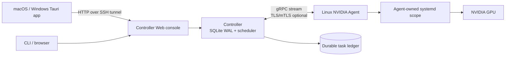

# GPU Scavenger


**GPU Scavenger is a host-first GPU control plane for shared Linux/NVIDIA machines.**
It gives operators a durable queue, capability-aware scheduling, explicit task
ownership, and a small Web/Tauri console without taking ownership of processes
or GPUs it did not create.

[中文说明](README.zh-CN.md) · [Design specification](gpu_scavenger.md) · [Releases](https://github.com/Deep-Octopus/gpu-scavenger/releases)

> **MVP status:** Linux x86_64 + NVIDIA NVML + cgroup v2 + systemd scopes is the
> verified scheduling boundary. The current release is suitable for controlled
> evaluation and internal GPU pools; APIs and operational defaults may change
> before 1.0.

## Why GPU Scavenger?

Shared GPU hosts make a simple queue surprisingly dangerous. A scheduler must
know which process it owns, distinguish a host demand from a task, release a GPU
only after verification, and stop scheduling a node when its boundary becomes
uncertain.

GPU Scavenger keeps those decisions explicit:

- the **Controller** stores the queue and durable task events in SQLite WAL;
- the **Agent** probes Linux/NVIDIA capabilities and runs tasks in its own
  systemd scope;
- the **core state machine** decides transitions without I/O;
- the **Web console** and native macOS shell are operator surfaces, not workers;
- unsupported hosts report `schedulable=false` and fail closed.

## What is included

| Area | Current capability |
| --- | --- |
| Scheduling | Durable queue, idempotent task submission, lease epochs, multi-Agent dispatch |
| Isolation | Agent-owned systemd/cgroup v2 scopes and ownership checks |
| GPU boundary | NVIDIA NVML inventory, process identity, MIG observation, release verification |
| Host demand | Claim file stops new work and drives release before the host is reported free |
| Recovery | Agent reconnect, task requeue, degraded and quarantined health states |
| Security | Loopback defaults, enrollment token, TLS/mTLS, certificate reload on `SIGHUP` |
| Operations | Prebuilt Linux runtime bundle with install/start/status/stop scripts |
| UI | Browser console plus macOS and Windows desktop shells that can connect through an SSH tunnel |

## Architecture



The normal deployment keeps the Controller and Agents on the GPU server. The
Mac runs only the operator console:

```text
MacBook                 GPU server
Tauri .app ──SSH tunnel──> Controller Web :18081
                           Controller gRPC :50051
                           Agent + NVIDIA GPUs
```

## Install a prebuilt Linux runtime

Download the latest release asset on a Linux x86_64 NVIDIA host:

```bash
curl -fL -o gpu-scavenger-linux-x86_64-0.1.0.tar.gz \
  https://github.com/Deep-Octopus/gpu-scavenger/releases/latest/download/gpu-scavenger-linux-x86_64-0.1.0.tar.gz
```

The published release page contains the SHA256 for the archive. Verify it before
installation, then install into an explicit prefix. `/share` is useful when the
root filesystem is constrained:

```bash
sha256sum gpu-scavenger-linux-x86_64-0.1.0.tar.gz
tar -xzf gpu-scavenger-linux-x86_64-0.1.0.tar.gz
cd gpu-scavenger-linux-x86_64-0.1.0
./install.sh --prefix /share/gpu-scavenger
cd /share/gpu-scavenger
./scripts/start.sh
./scripts/status.sh
```

The bundle contains the already-built Controller and Agent, a configuration
template, an internal binary checksum file, and lifecycle scripts. It does not
run Cargo or Rustup on the target host, install Docker, write a systemd unit, or
modify services outside the chosen prefix.

See [`packaging/linux/README.md`](packaging/linux/README.md) for configuration,
SSH forwarding, stopping, and uninstalling. To produce a bundle from an
existing Linux build, run:

```bash
packaging/linux/build-bundle.sh \
  --binary-dir /path/to/linux-target/release \
  --output dist/gpu-scavenger-linux-x86_64-0.1.0.tar.gz
```

The packaging step never compiles Rust and creates reproducible archives.

## Run from source

### Requirements

- Rust 1.77 or newer;
- Linux x86_64 for a schedulable Agent;
- NVIDIA driver with NVML, cgroup v2, and systemd scopes on the worker host;
- Node.js/npm only when building the Tauri desktop shell.

The workspace also builds on macOS for protocol, Controller, Web, and desktop
development. macOS itself reports as unschedulable and does not run GPU tasks.

### Controller

```bash
cargo run -p scavenger-controller -- serve \
  --db /tmp/gpu-scavenger/controller.sqlite3 \
  --listen 127.0.0.1:50051 \
  --web-listen 127.0.0.1:18080
```

Open `http://127.0.0.1:18080`. Keep the Web and gRPC listeners on loopback
unless TLS/mTLS and an enrollment token are configured.

### Agent

```bash
cargo run -p scavenger-agent -- probe
cargo run -p scavenger-agent -- run \
  --controller http://127.0.0.1:50051 \
  --agent-id "$(hostname)" \
  --claim-path /tmp/gpu-scavenger/claim
```

Use `scavenger-agent claim` when a host owner needs the node back and
`scavenger-agent unclaim` after the demand is cleared. The default task policy
is `stateless`; checkpointed tasks require the checkpoint file and `SIGUSR1`
protocol described in [`gpu_scavenger.md`](gpu_scavenger.md).

### Queue a task from the CLI

```bash
cargo run -p scavenger-controller -- enqueue \
  --db /tmp/gpu-scavenger/controller.sqlite3 \
  --task-id demo-01 \
  --device-uuid GPU-... \
  --program /usr/local/bin/my-gpu-task \
  --arg=--epochs --arg=10
```

The Web console exposes the same bounded task submission path. Only use a
program and working directory that the Agent host is expected to execute.

## Use the macOS desktop shell

The native shell is an operator console. GPU work remains on Linux/NVIDIA
Agents.

Build the `.app` locally:

```bash
npx --yes @tauri-apps/cli@2.12.4 build --bundles app
open "target/release/bundle/macos/GPU Scavenger.app"
```

For a remote Controller, create a loopback SSH tunnel and pass the forwarded
Web URL to the app:

```bash
ssh -N -L 18082:127.0.0.1:18081 <user>@<gpu-server>
open -n "target/release/bundle/macos/GPU Scavenger.app" --args \
  --controller-url http://127.0.0.1:18082
```

The v0.1.0 release includes a macOS Apple Silicon `.app` archive and the
Windows x64 MSI/NSIS installers. Windows is an operator surface; GPU execution
still stays on Linux/NVIDIA Agents.

## Use the Windows desktop shell

Download either Windows x64 installer from the [v0.1.0 release](https://github.com/Deep-Octopus/gpu-scavenger/releases/tag/v0.1.0):

- `GPU-Scavenger-windows-x64.msi` for a standard Windows Installer flow;
- `GPU-Scavenger-windows-x64-setup.exe` for the NSIS installer flow.

After installation, forward the Controller Web port from the GPU server and
launch GPU Scavenger with the forwarded URL:

```powershell
ssh -N -L 18082:127.0.0.1:18081 <user>@<gpu-server>
```

Then start the installed app with `--controller-url
http://127.0.0.1:18082`. The Windows app renders the same operator console as
the macOS shell; it does not probe or run GPU work locally.

## Security and ownership model

GPU Scavenger is deliberately conservative on a shared host:

1. An Agent acts only on task scopes and processes it created.
2. A host Claim blocks new work and requires release verification before the
   device is reported free.
3. Ambiguous process identity, missing capability boundaries, and uncertain
   health fail closed.
4. Default listeners are loopback-only; remote operation uses an SSH tunnel or
   explicitly configured TLS/mTLS.
5. Stop and uninstall scripts validate their own PID files and binary paths
   before sending a signal or removing a prefix.

Do not use a GPU index, memory usage, or an unrelated PID as an ownership
identifier. Do not run cleanup commands that affect other users' workloads.

## Verification

Local checks required by the repository are:

```bash
cargo fmt --all -- --check
cargo clippy --workspace --all-targets -- -D warnings
cargo test --workspace
```

Remote acceptance records for the verified Linux/NVIDIA boundary are in:

- [`docs/sprint0-sprint1-acceptance-20261112.md`](docs/sprint0-sprint1-acceptance-20261112.md)
- [`docs/sprint2-acceptance-20261112.md`](docs/sprint2-acceptance-20261112.md)
- [`docs/sprint3-sprint4-acceptance-20261112.md`](docs/sprint3-sprint4-acceptance-20261112.md)

These records distinguish real-host evidence from unit tests and identify the
GPU, paths, ports, and ownership boundaries used during acceptance.

## Project layout

```text
crates/scavenger-core        Pure state transitions and release policy
crates/scavenger-protocol    Versioned protobuf control stream
crates/scavenger-controller  Durable queue, scheduler, Web API and console
crates/scavenger-agent       NVML probe, claims, scopes and task execution
apps/scavenger-desktop       Tauri macOS operator shell
packaging/linux              Prebuilt runtime bundle and lifecycle scripts
docs                         Design, acceptance, and release records
```

## Contributing

Small, reviewable changes are preferred. Before opening a pull request:

```bash
cargo fmt --all -- --check
cargo clippy --workspace --all-targets -- -D warnings
cargo test --workspace
```

Read [`CLAUDE.md`](CLAUDE.md) for the repository's engineering constraints and
[`CONTRIBUTING.md`](CONTRIBUTING.md) for the change and review workflow.

## License

GPU Scavenger is dual-licensed under the [Apache License, Version 2.0](LICENSE-APACHE)
or the [MIT License](LICENSE-MIT), at your option.
